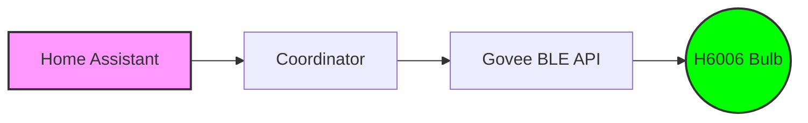

# Govee H6006 BLE Integration for Home Assistant 🏠

[](https://github.com/hacs/integration)
[](https://github.com/flippinhutt/govee/actions/workflows/ci.yml)
[](https://github.com/flippinhutt/govee/releases/)
[](https://github.com/flippinhutt/govee/releases/)


## Overview

**Control your Govee H6006 lights locally via Bluetooth — zero cloud dependency, zero API keys, zero MQTT broker.**

This Home Assistant custom integration discovers and controls Govee H6006 Bluetooth lights directly through your Home Assistant server's Bluetooth adapter. No internet connection required, no third-party services, just pure local control.

### Key Features

- **🔒 100% Local**: All communication stays on your local network via Bluetooth Low Energy (BLE)
- **⚡ Auto-Discovery**: Devices appear automatically — no manual configuration needed
- **✨ Smooth Transitions**: Support for soft, configurable transition durations for brightness and color
- **🎨 Full Control**: Brightness, color (RGB), and on/off state
- **🛡️ Robust Connection**: Unified locking and exponential backoff for high reliability
- **🚫 No Cloud**: Never talks to Govee's servers or requires API keys
- **🔌 Simple Setup**: If you have a Bluetooth adapter, you're ready to go

## 📚 Documentation

Detailed documentation is available in the `docs/` folder:

- **[Architecture Guide](docs/ARCHITECTURE.md)**: Deep dive into the component design and data flow.
- **[Internal API Reference](docs/API.md)**: Technical details on classes, methods, and BLE packets.
- **[Govee Protocol Reference](CLAUDE.md#protocol-reference)**: Quick reference for BLE command frames.

### Supported Devices

This integration supports the following Govee BLE bulb models:

| Model | Discovery Prefix | Power | Brightness | RGB | Color Temp | Range | Additional Features |
|-------|-----------------|-------|------------|-----|------------|-------|---------------------|
| **H6006** | `ihoment_H6006` | ✅ | ✅ | ✅ | ✅ | 2700K-6500K | RGBWW, 800 lm, 9W |
| **H6008** | `ihoment_H6008` | ✅ | ✅ | ✅ | ✅ | 2700K-6500K | RGBWW, 800 lm, 9W |
| **H6009** | `ihoment_H6009` | ✅ | ✅ | ✅ | ✅ | 2700K-6500K | RGBWW, 1200 lm, 12W, Music Sync*, Scene Modes* |
| **H6003** | `ihoment_H6003` | ✅ | ✅ | ✅ | ❌ | N/A | RGB only, 800 lm, 9W |

*\*Music Sync and Scene Modes support is planned but not yet implemented in the current release.*

**Notes:**
- All models are auto-discovered via Bluetooth using their respective discovery prefixes
- H6006 protocol is hardware-verified; H6008, H6009, and H6003 are based on protocol research and expected to be compatible
- All RGBWW models (H6006, H6008, H6009) support the full color temperature range of 2700K-6500K
- H6003 is RGB-only and does not support color temperature control

## Installation

### HACS (Recommended)

1. Ensure [HACS](https://hacs.xyz/) is installed in Home Assistant
2. Open HACS in Home Assistant
3. Go to any of the sections (integrations, frontend, automation)
4. Click on the 3 dots in the top right corner
5. Select "Custom repositories"
6. Add the following URL: `https://github.com/flippinhutt/govee`
7. Select **Integration** as the category
8. Click the "ADD" button
9. Search for "Govee H6006 BLE"
10. Click "Download"
11. Restart Home Assistant

### Manual Installation

To install manually, download [the latest release](https://github.com/flippinhutt/govee/releases/latest/) and extract the contents to your `config/custom_components` directory:

```bash
cd /config  # or wherever your Home Assistant config directory is
mkdir -p custom_components
cd custom_components
wget https://github.com/flippinhutt/govee/releases/latest/download/govee_h6006.zip
unzip govee_h6006.zip -d govee_h6006
rm govee_h6006.zip
```

Then restart Home Assistant.

## Configuration

### Prerequisites

- **Bluetooth Adapter**: Your Home Assistant server must have a working Bluetooth adapter
- **Bluetooth Integration**: The built-in Home Assistant [Bluetooth integration](https://www.home-assistant.io/integrations/bluetooth/) must be enabled (it usually is by default on Home Assistant OS)

### Setup Steps

[](https://my.home-assistant.io/redirect/config_flow_start/?domain=govee_h6006)

1. From the Home Assistant dashboard, go to **Settings** → **Devices & Services**
2. Click the **+ Add Integration** button in the bottom right
3. Search for "Govee H6006 BLE"
4. Select the integration from the list
5. Your Govee H6006 lights should be discovered automatically
6. Select the device you want to add and click **Submit**

That's it! Your lights will appear as standard Home Assistant light entities.

## Multi-Device Support

This integration supports controlling multiple Govee H6006 devices simultaneously. You can add as many devices as your Bluetooth adapter can handle, and each will appear as a separate light entity in Home Assistant.

### How to Add Multiple Devices

Simply repeat the setup process for each device:
1. Go to **Settings** → **Devices & Services**
2. Click **+ Add Integration**
3. Search for "Govee H6006 BLE" and select it
4. Choose the next device from the discovered list

Each device operates independently with its own connection and state tracking.

### BLE Adapter Limitations

**Important**: Bluetooth Low Energy (BLE) adapters have physical limitations that affect multi-device setups:

#### Connection Limits
- **Typical BLE adapters support 3-7 simultaneous connections**
- The exact limit depends on your Bluetooth adapter chipset and driver
- If you exceed your adapter's limit, devices may fail to connect or become unreliable
- **Recommendation**: For more than 5 devices, consider using multiple Bluetooth adapters or ESPHome Bluetooth proxies

#### Range and Interference
- **BLE range**: ~10-30 feet (3-10 meters) in ideal conditions
- **Signal degradation**: Each wall, floor, or obstacle reduces range significantly
- **Interference sources**: 2.4GHz Wi-Fi, USB 3.0 ports, microwaves, other Bluetooth devices
- **Multi-device impact**: With multiple devices spread across different rooms, some may be out of range

#### Solutions for Large Deployments

If you have many devices or a large home:

**Option 1: Multiple Bluetooth Adapters**
- Add USB Bluetooth adapters to extend coverage
- Each adapter can handle 3-7 devices
- Place adapters in different areas of your home for better range
- Use USB extension cables to position adapters optimally

**Option 2: ESPHome Bluetooth Proxies**
- Deploy [ESPHome Bluetooth proxies](https://esphome.io/components/bluetooth_proxy.html) using ESP32 devices
- Each ESP32 acts as a Bluetooth bridge to extend range
- More cost-effective than multiple USB adapters for large homes
- Provides better coverage across multiple rooms

**Option 3: Dedicated Bluetooth Server**
- Run Home Assistant on a device with a better Bluetooth adapter (e.g., Raspberry Pi with external adapter)
- Use a powered USB hub with USB extension cables to position multiple adapters

### Performance Tips

- **Stagger device polling**: The integration polls each device every 30 seconds. With many devices, this spreads naturally over time.
- **Monitor connection count**: Enable debug logging to see how many concurrent connections your adapter maintains.
- **Group devices by location**: If you have devices in different areas, consider which adapter/proxy can reach them reliably.

### Check Your Current Limits

To see how many BLE devices your adapter currently supports:

```bash
# On your Home Assistant server
bluetoothctl
# Then run:
show
```

Look for "Connected" devices. If you're approaching 5-7 active connections and experiencing issues, you've likely hit your adapter's limit.

## Troubleshooting

### Devices Not Discovered

**Problem**: Your Govee H6006 lights don't appear during setup.

**Solutions**:
- **Check Bluetooth range**: BLE has limited range (~10-30 feet / 3-10 meters). Move your lights closer to the Home Assistant server or vice versa.
- **Restart the lights**: Power cycle your Govee lights by turning them off and on again at the wall switch or power adapter.
- **Check Bluetooth adapter**: Run `bluetoothctl` on your Home Assistant server and verify the adapter is working with `list` and `scan on`.
- **Interference**: 2.4GHz Wi-Fi, microwaves, and other Bluetooth devices can interfere with BLE. Try turning off nearby 2.4GHz devices temporarily.

### BLE Adapter Placement Tips

For best results:
- **Keep the Bluetooth adapter away from USB 3.0 ports and cables** — USB 3.0 generates interference in the 2.4GHz band
- **Use a USB extension cable** to position the Bluetooth adapter away from the server chassis and closer to your lights
- **Avoid metal enclosures** — if your Home Assistant server is in a metal case, the case can block BLE signals
- **Minimize obstacles** — BLE signals don't penetrate walls well, especially concrete or metal

### Connection Drops or Slow Response

**Problem**: Lights disconnect frequently or commands are slow.

**Solutions**:
- **Reduce distance**: Move the Bluetooth adapter closer to the lights
- **Check for interference**: Other BLE devices, Wi-Fi routers, and USB 3.0 devices can cause interference
- **Reduce BLE device count**: BLE adapters have a limited number of simultaneous connections (usually 3-7 devices)
- **Enable debug logging** (see below) to identify connection issues

### Enable Debug Logging

To troubleshoot issues, enable debug logging for the integration:

1. Go to **Settings** → **Devices & Services** → **Govee H6006 BLE**
2. Click **Enable debug logging**

Or add this to your `configuration.yaml`:

```yaml
logger:
  default: info
  logs:
    custom_components.govee_h6006: debug
    bleak: debug
```

Then restart Home Assistant and check the logs under **Settings** → **System** → **Logs**.

### Device Shows as "Unavailable"

**Problem**: Device appears in Home Assistant but shows as "Unavailable".

**Solutions**:
- The device may be out of Bluetooth range
- The device may be powered off
- Another application or Bluetooth device may have connected to it
- Try reloading the integration: **Settings** → **Devices & Services** → **Govee H6006 BLE** → **⋮** → **Reload**

## Protocol Documentation

This integration uses Govee's proprietary Bluetooth Low Energy (BLE) protocol to communicate with H6006 devices. The protocol is reverse-engineered and uses BLE GATT characteristics for control.

### Technical Details

The integration is built on a robust architecture designed for Home Assistant:



- **Service**: Uses standard BLE GATT services
- **Discovery**: Devices advertise as `ihoment_*` via BLE advertising packets
- **Commands**: Power, brightness, and RGB color are sent via GATT characteristic writes
- **State Polling**: Device state is read periodically via GATT characteristic reads

For more details, see the **[Architecture Overview](docs/ARCHITECTURE.md)**.

## 🤝 Contributing

We welcome contributions from the community! Whether you want to report a bug, request a feature, or add support for a new Govee device, there are many ways to help make this integration better.

### Contribution Guides

- **[CONTRIBUTING.md](CONTRIBUTING.md)**: Main contribution guide covering code standards, development setup, testing requirements, and the pull request process.
- **[Developer Guide](docs/CONTRIBUTING_DEVELOPER_GUIDE.md)**: Step-by-step instructions for adding support for new Govee BLE devices, including protocol reverse engineering and testing.
- **[BLE Protocol Sniffing Tutorial](docs/BLE_PROTOCOL_SNIFFING.md)**: Learn how to capture and analyze Bluetooth traffic using tools like nRF Connect, Wireshark, and btmon.

### Quick Links

- **Report a bug**: [Submit a bug report](https://github.com/flippinhutt/govee/issues/new/choose)
- **Request a feature**: [Request a feature](https://github.com/flippinhutt/govee/issues/new/choose)
- **Request device support**: [Request device support](https://github.com/flippinhutt/govee/issues/new/choose)
- **Ask questions**: Join the conversation in [GitHub Discussions](https://github.com/flippinhutt/govee/discussions)

### Adding Support for New Models

Have a different Govee BLE device? We'd love to add support for it! Check out the **[Developer Guide](docs/CONTRIBUTING_DEVELOPER_GUIDE.md)** and **[BLE Protocol Sniffing Tutorial](docs/BLE_PROTOCOL_SNIFFING.md)** to learn how to reverse engineer the protocol and contribute support for your device.

Before starting, please open a **Device Support Request** issue to coordinate with other contributors and share your findings.

## Disclaimer

This custom integration is not officially endorsed or supported by Govee.
Use it at your own risk and ensure that you comply with all relevant terms of service and privacy policies.

---

**Enjoy your locally-controlled Govee lights! 💡**
