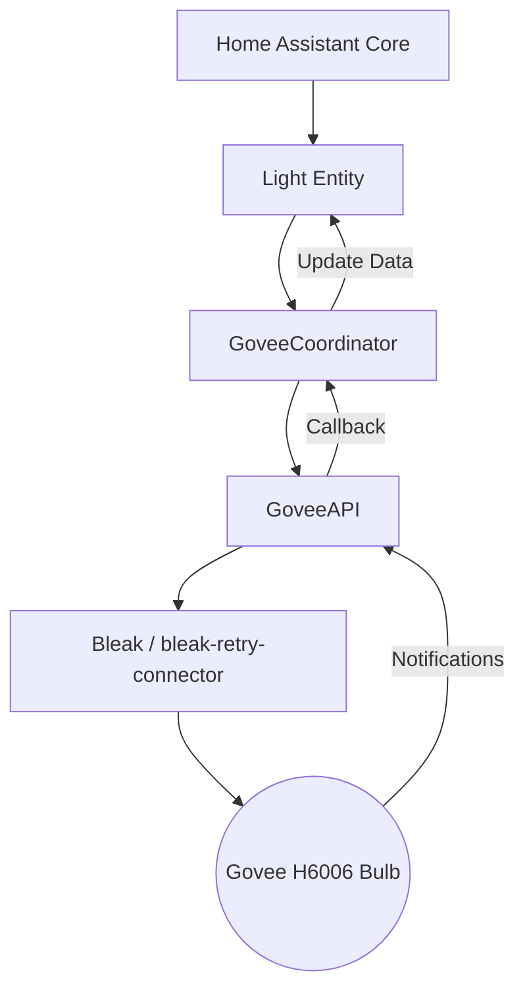

# Architecture Overview - Govee H6006 BLE Integration

This document describes the architectural design and data flow of the Govee H6006 BLE Home Assistant integration.

## System Architecture

The integration follows the standard Home Assistant Design Pattern for Data Update Coordinators, specifically tailored for Bluetooth Low Energy (BLE) communication.

## Key Components

### [GoveeAPI](file:///Users/ryanhutto/projects/govee/custom_components/govee_h6006/api.py)
The low-level interface for Bluetooth communication.
- **Connection Management**: Uses `bleak-retry-connector` for robust persistent connections with automatic retries and exponential backoff.
- **Packet Engineering**: Builds 20-byte command frames (Head `0x33`) and state-query frames (Head `0xAA`).
- **Notification Handling**: Parses asynchronous BLE notifications from the device to keep the local state in sync.
- **Optimistic Locking**: Prevents concurrent GATT operations on the same device.

### [GoveeCoordinator](file:///Users/ryanhutto/projects/govee/custom_components/govee_h6006/coordinator.py)
The primary data management layer.
- **Data Synchronization**: Maintains the `GoveeData` snapshot shared across entities.
- **Polling Strategy**: Implements a 30-second polling fallback to ensure state consistency even if notifications are missed.
- **Optimistic Updates**: Immediately updates the internal state when a command is sent, providing instant UI feedback.

### [GoveeLight](file:///Users/ryanhutto/projects/govee/custom_components/govee_h6006/light.py)
The Home Assistant entity representation.
- Maps standard Home Assistant services (`light.turn_on`, `light.turn_off`) to coordinator methods.
- Exposes attributes like brightness, RGB color, and color temperature.

## Data Flow

### Command Execution (Write)

1. User interacts with the Home Assistant Dashboard.
2. `GoveeLight.async_turn_on` is called.
3. `GoveeCoordinator` performs an **optimistic update**, refreshing the UI immediately.
4. `GoveeAPI` sends the BLE command.
5. `GoveeAPI` suppresses incoming notifications for 500ms to prevent the device's "old" state from overwriting the optimistic local update.

### State Updates (Read/Push)

- **Push (Primary)**: The device sends GATT notifications when its state changes (e.g., via the physical switch or the Govee app). `GoveeAPI` parses these and notifies the coordinator.
- **Poll (Fallback)**: Every 30 seconds, the coordinator requests a full state update from the device via `GoveeAPI.poll_state()`.

## Resilience and Stability

- **Adaptive Backoff**: Connection retries follow an exponential backoff schedule (1s, 2s, 4s, 8s, 16s) up to 5 attempts.
- **Cooldown Period**: If a device becomes unreachable, the integration enters a cooldown state for 60 seconds before resetting retry counters, preventing excessive CPU/Bluetooth usage.
- **Unified Locking**: Uses a single `asyncio.Lock` to ensure only one connection attempt or command write occurs at a time per device, preventing race conditions.
- **Configurable Suppression**: Dynamically adjusts the notification suppression window (default 500ms) to prevent stale device state from overwriting optimistic updates.
